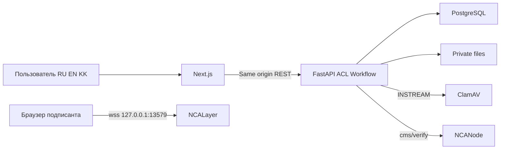
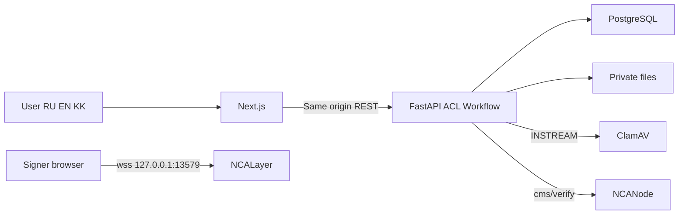

# NEXORA

**[Русский](#русский)** · **[English](#english)**

---

# Русский

**NEXORA — корпоративная система документооборота (DMS) с согласованиями, контролем доступа и электронной
подписью.** Portfolio-проект: Iteration 1 и последующие enterprise-инкременты. Наличие реализации в коде не означает
её внедрения в рабочую среду и не является сертификацией готовности к production.

## 1. Что это и зачем

NEXORA регистрирует корпоративные документы, хранит их метаданные и неизменяемые версии файлов, проводит документы
через маршруты согласования и фиксирует каждое значимое действие в аудите. Интерфейс на русском (по умолчанию),
английском и казахском. Работает локально, без внешних AI и облачных сервисов.

## 2. Возможности

**Документы**

- Регистрация документа с автоматическим номером, метаданные, поиск и фильтры.
- Приватные **неизменяемые версии** файлов PDF/DOCX/TXT, скачивание, восстановление старой версии как новой,
  сравнение версий TXT.
- Жизненный цикл: `DRAFT` → `SUBMITTED` → `APPROVED`/`REJECTED`, а также `CANCELLED`, `ARCHIVED`.
- Классификация: `PUBLIC`, `INTERNAL`, `CONFIDENTIAL`, `RESTRICTED`.
- Папки с вложенностью и «хлебными крошками», перемещение; виды «Все / Мои / Избранное / Архив / Корзина»;
  удаление в корзину и восстановление с аудитом.
- Типы документов и пользовательские поля, которые задаёт администратор; формы RU/EN генерируются автоматически.
- Комментарии и лента активности документа.

**Согласование (workflow)**

- Версионируемые шаблоны маршрутов: последовательные, параллельные и условные этапы, дедлайны.
- Обязательные маршруты по типу документа и классификации.
- Решения согласующих (одобрить, отклонить, вернуть на доработку) с идемпотентностью.
- Экземпляр маршрута закрепляет снимок шаблона, файла и метаданных.
- Уведомления в приложении + email-outbox (SMTP), одноразовая эскалация просроченных задач.

**Доступ и безопасность**

- 6 ролей: `USER`, `REVIEWER`, `APPROVER`, `LEGAL`, `MANAGER`, `ADMIN`; подразделения.
- Политика чтения: владелец, руководитель подразделения, администратор и назначенный участник маршрута; чужие
  документы возвращают 404 (защита от BOLA).
- ACL Revision 2: доступ участника текущего этапа к закреплённой версии, временные персональные допуски,
  независимые подтверждения для `RESTRICTED`, квитанции ревью без файла. Технический ADMIN не получает содержимое
  автоматически.
- Вход по паролю (Argon2id), серверные сессии, CSRF, ограничение попыток входа, список сессий и их отзыв.
- Обязательный CAS (сравнение версии) для PATCH и долговечные ключи повторных операций.
- Антивирус ClamAV с карантином (fail-closed) и аттестациями проверенных версий.
- **Электронная подпись (ЭЦП) через NCALayer** с проверкой на сервере через NCANode.
- Аудит действий администратора и документов.

**Эксплуатация**

- Dashboard из реальных данных.
- Резервное копирование с проверкой восстановления в изолированной БД.
- Безопасная очистка неиспользуемых файлов оператором.
- Разделение ролей PostgreSQL (`compose.roles.yaml`).

## 3. Стек технологий

| Слой | Технологии |
| --- | --- |
| Backend | Python, FastAPI, Uvicorn, SQLAlchemy 2 (синхронные сессии), Alembic, psycopg 3, pydantic-settings, argon2-cffi, python-multipart |
| Frontend | Next.js 16, React 19, TypeScript 5.8, ESLint 9; локализация RU/EN/KK |
| База данных | PostgreSQL (источник истины), последовательности для номеров, `SELECT FOR UPDATE` для версий и жизненного цикла |
| Файлы | Приватное локальное хранилище за интерфейсом, SHA-256, проверка типа PDF/DOCX/TXT |
| Антивирус | ClamAV (протокол INSTREAM) — `compose.security.yaml` |
| ЭЦП | NCALayer (в браузере подписанта) + NCANode (проверка CMS и OCSP на сервере) |
| Почта | SMTP (необязательно) |
| Инфраструктура | Docker Compose: `compose.yaml` (dev), `compose.production.yaml`, `compose.security.yaml`, `compose.roles.yaml` |
| Тесты | pytest (132 теста API и ops, unit + интеграция с PostgreSQL), тесты frontend, Playwright e2e, ruff, mypy |
| CI | GitHub Actions: API (ruff, mypy, alembic check, pytest), Web (test, lint, typecheck, build, npm audit), E2E (Playwright) |

## 4. Архитектура



Ключевые решения:

1. **Модульный монолит** в `apps/api` и `apps/web`: независимые зависимости и контейнеры, общая документация.
2. **PostgreSQL — источник истины.** Синхронные сессии SQLAlchemy делают критичные транзакции явными; схемой владеет
   Alembic.
3. **Непрозрачные серверные сессии:** хеши токенов в БД, HttpOnly SameSite=Lax cookie, CSRF-заголовок, проверка
   Origin; токены не хранятся в браузере. Срок сессии и статус ACTIVE проверяются на каждом запросе.
4. **Одна политика доступа** для списков, счётчиков и всех дочерних ресурсов. Роли REVIEWER/APPROVER/LEGAL сами по
   себе не дают глобального доступа.
5. **Номера документов** — из последовательности PostgreSQL; запись версий и жизненного цикла сериализуется
   `SELECT FOR UPDATE`.
6. **Приватное хранилище:** потоковая загрузка с лимитом, сгенерированные ключи, SHA-256; при откате транзакции файл
   удаляется.
7. **Браузер обращается к API через rewrite Next.js** (same-origin); загрузки никогда не отдаются как статика.
8. **Решения по маршрутам** принимают детерминированные правила backend.

## 5. Структура проекта

```text
apps/api/
  app/main.py              FastAPI-приложение, /api/v1, health/ready/capabilities
  app/auth.py              вход, сессии, отзыв
  app/documents.py         документы, версии, переходы, комментарии, активность
  app/dms.py               папки, избранное, корзина, восстановление, сравнение версий
  app/workflows.py         шаблоны, экземпляры, решения, задачи согласования
  app/workflow_escalation.py  эскалация просрочек
  app/access.py, policy.py ACL: запросы доступа, допуски, подтверждения, квитанции
  app/catalog.py           подразделения, типы документов, пользователи, dashboard, аудит
  app/custom_fields.py     пользовательские поля
  app/notifications.py, notification_dispatch.py   уведомления и email-outbox
  app/signatures.py        ЭЦП (NCANode)
  app/scanning.py, scan_existing.py   ClamAV, карантин, аттестации
  app/storage.py           приватное хранилище файлов
  app/operation_keys.py, idempotency.py   ключи повторных операций
  app/cleanup.py, auth_cleanup.py, operation_key_cleanup.py   очистка
  app/audit.py, body_limit.py, client_ip.py, config.py, db.py, models.py, schemas.py
  app/seed.py, demo.py     development seed и демо-компания
  migrations/              Alembic
  tests/                   pytest
apps/web/
  src/app/login            вход
  src/app/(workspace)/     dashboard, documents (список, новый, карточка), approvals, access,
                           notifications, settings/security, admin (users, document-types, workflows, audit)
  src/components, src/lib  компоненты, API-клиент, i18n (RU/EN), i18n-kk, ncalayer.ts
  e2e/                     Playwright-тесты
  tests/                   unit-тесты (api, csp, i18n, ncalayer)
ops/                       backup.py, audit_backups.py, database_roles.py, verify_*.py, ACL lab
docs/                      архитектура, продукт, безопасность, API, данные, итерации, решения, system-analysis/
compose*.yaml              Docker Compose
AGENTS.md                  правила для AI-агентов
```

## 6. Модель данных (PostgreSQL)

| Таблица | Что хранит |
| --- | --- |
| `departments` | Подразделения |
| `users` | Пользователи: email, имя, роль, подразделение, статус, хеш пароля |
| `auth_sessions`, `login_throttles` | Сессии (хеш токена) и ограничение попыток входа |
| `document_types` | Типы документов RU/EN и их пользовательские поля |
| `documents` | Документы: номер, название, тип, статус, классификация, владелец, подразделение, папка, текущая версия, метаданные |
| `document_versions` | Неизменяемые версии файлов (ключ хранилища, размер, SHA-256, MIME) |
| `folders`, `document_favorites` | Папки и избранное |
| `comments` | Комментарии |
| `audit_events` | Аудит |
| `workflow_templates`, `workflow_instances`, `approvals`, `workflow_events`, `workflow_requirements` | Шаблоны маршрутов, экземпляры, задачи согласования, события, обязательные маршруты |
| `file_scans` | Результаты антивирусной проверки и аттестации |
| `acl_authorities`, `acl_department_policies`, `access_grants`, `grant_endorsements` | Полномочия, политики подразделений, допуски и их подтверждения |
| `review_receipts`, `receipt_revocations` | Квитанции ревью и их отзыв |
| `operation_keys` | Ключи повторных операций (идемпотентность) |
| `notifications` | Уведомления |
| `document_signatures` | Электронные подписи (CMS, данные сертификата от верификатора) |

Подробно: [docs/data-model.md](docs/data-model.md), [ERD](docs/system-analysis/11-data-model.md).

## 7. API (`/api/v1`)

| Группа | Эндпоинты |
| --- | --- |
| Служебные | `GET /health`, `GET /ready`, `GET /capabilities` |
| Вход и сессии | `POST /auth/login`, `GET /auth/me`, `POST /auth/logout`, `GET /auth/sessions`, `POST /auth/sessions/revoke-others`, `DELETE /auth/sessions/{id}`, `POST /auth/users/{id}/sessions/revoke` |
| Справочники | `GET /departments`, `GET/POST /document-types`, `PATCH /document-types/{id}`, `GET /users`, `PATCH /users/{id}`, `GET /dashboard`, `GET /audit` |
| Документы | `GET/POST /documents`, `GET/PATCH /documents/{id}`, `POST /documents/{id}/transitions`, `GET/POST /documents/{id}/versions`, `GET /documents/{id}/versions/{vid}/download`, `GET/POST /documents/{id}/comments`, `GET /documents/{id}/activity` |
| DMS | `GET/POST /folders`, `PATCH /folders/{id}`, `GET /folders/{id}/breadcrumbs`, `POST /documents/{id}/move`, `PUT/DELETE /documents/{id}/favorite`, `POST /documents/{id}/trash`, `POST /documents/{id}/restore`, `POST /documents/{id}/versions/{vid}/restore`, `GET /documents/{id}/versions/{vid}/diff/{other}` |
| Согласование | `GET/POST /workflow-templates`, `GET/POST /documents/{id}/workflows`, `POST /workflows/{id}/decisions`, `GET /approvals`, `GET /approvals/{id}/review` |
| Доступ | `POST /documents/{id}/access-requests`, `POST /approvals/{id}/access-requests`, `GET /access/grants`, `POST /access/grants/{id}/endorse`, `POST /access/grants/{id}/revoke`, `PUT /departments/{id}/review-policy`, `POST /documents/{id}/department-review`, `GET /approvals/{id}/receipt`, `POST /approvals/{id}/receipt/revoke`, `GET /access/people`, `GET /access/authority` |
| Уведомления | `GET /notifications`, `GET /notifications/summary`, `POST /notifications/{id}/read`, `POST /notifications/read-all` |
| ЭЦП | `GET /documents/{id}/signatures`, `POST /documents/{id}/versions/{vid}/signatures`, `GET /documents/{id}/signatures/{sid}/cms` |
| Повторные операции | `POST /operation-keys` |

OpenAPI: http://localhost:8000/api/docs, спецификация: [docs/api.md](docs/api.md),
[фактический OpenAPI](docs/system-analysis/openapi/fastapi.openapi.json).

## 8. Конфигурация (`.env`)

| Переменная | Пример / по умолчанию | Назначение |
| --- | --- | --- |
| `POSTGRES_DB`, `POSTGRES_USER`, `POSTGRES_PASSWORD` | `nexora`, `nexora`, `local-development-only` | База данных |
| `APP_ENV` | `development` | `development` или `production` |
| `WEB_ORIGIN` | `http://localhost:3000` | Адрес UI (должен совпадать с адресом браузера) |
| `WEB_PORT`, `API_PORT`, `POSTGRES_PORT` | 3000, 8000, 5432 | Порты |
| `SEED_DEMO`, `DEMO_PASSWORD` | `true`, — | Демо-данные и пароль демо-аккаунтов |
| `TRUSTED_PROXIES` | `web` | Доверенные прокси для определения IP |
| `MALWARE_SCANNER` | `disabled-development` | `clamav` в production |
| `CLAMAV_HOST`, `CLAMAV_PORT` | `clamav`, 3310 | Адрес ClamAV |
| `SIGNATURE_VERIFIER`, `NCANODE_URL` | `none`, — | Проверка ЭЦП (`ncanode`) |
| `SMTP_HOST`, `SMTP_PORT`, `SMTP_USERNAME`, `SMTP_PASSWORD`, `SMTP_FROM`, `SMTP_STARTTLS` | —, 587 | Отправка email-уведомлений |
| `OPERATION_KEY_SECRET`, `OPERATION_KEY_TTL_DAYS` | —, 30 | Подпись и срок ключей повторных операций |
| `STORAGE_ROOT`, `MAX_UPLOAD_BYTES`, `SESSION_HOURS` | `/data/uploads`, 20 МБ, 12 | Хранилище, лимит загрузки, срок сессии |

## 9. Первый запуск (Windows)

Требуется Docker Desktop с Linux-контейнерами. Python и Node на хосте не обязательны.

```powershell
cd C:\Users\zamirzhan.janbakiyev\Projects\nexora
# Копировать только если .env ещё не существует:
Copy-Item .env.example .env
docker compose up --build
```

По умолчанию UI http://localhost:3000, API http://localhost:8000/api/docs. Если порт занят, измените `WEB_PORT`,
`API_PORT`, `POSTGRES_PORT` в `.env`; `WEB_ORIGIN` должен совпадать с адресом браузера.
**Подготовленный локальный `.env` использует UI 3300, API 8800, PostgreSQL 55432 из-за занятых стандартных портов.**

Миграции и seed запускаются автоматически. PostgreSQL и загрузки сохраняются в named volumes. Остановка:
`docker compose stop` (не удаляйте volumes, если нужны данные).

С антивирусом: `docker compose -f compose.yaml -f compose.security.yaml up -d --build`.

### Development-аккаунты

`user@nexora.local`, `reviewer@nexora.local`, `approver@nexora.local`, `legal@nexora.local`,
`manager@nexora.local`, `admin@nexora.local`, `other@nexora.local`. Пароль задаёт `DEMO_PASSWORD` в `.env`.
Только синтетические локальные аккаунты. Seed требует `APP_ENV=development` и `SEED_DEMO=true`, повторный запуск не
сбрасывает пароли. LEGAL/other относятся к подразделению LEGAL, остальные — к IT. Для проверки BOLA создайте
документ под USER и откройте под other.

### Локально без Docker

Backend: `python -m venv .venv`, `.venv\Scripts\python -m pip install -r requirements.lock`,
`.venv\Scripts\python -m pip install --no-deps -e .`; `DATABASE_URL` и `STORAGE_ROOT` задаются окружением.
Frontend: задайте `API_INTERNAL_URL` **до** `npm run build` (rewrite фиксируется при сборке).

## 10. Проверки и тесты

```powershell
docker compose config --quiet
docker compose exec api python -m ruff check .
docker compose exec api python -m mypy app
docker compose exec api alembic check
# Создать одноразовую тестовую БД один раз:
docker compose exec db psql -U nexora -d nexora -c "CREATE DATABASE nexora_test"
docker compose exec -e NEXORA_TEST_DATABASE_URL=postgresql+psycopg://nexora:local-development-only@db:5432/nexora_test api python -m pytest -q -o cache_dir=/tmp/nexora-pytest
cd apps/web
npm ci
npm run test
npm run lint
npm run typecheck
npm run build
```

Интеграционные тесты принимают только БД `nexora_test` и очищают только её. Без `NEXORA_TEST_DATABASE_URL` они
пропускаются; unit-тесты работают. Не используйте рабочую БД.

## 11. Эксплуатация

- **Эскалация просрочек:** `python -m app.workflow_escalation` (пробный прогон), `--apply` — применить.
- **Проверка старых файлов антивирусом:** `python -m app.scan_existing`, затем `--apply`.
- **Очистка:** `python -m app.cleanup` (пробный прогон), `--apply` — удалить старые неиспользуемые файлы (минимум 24 ч).
- **Backup и проверка восстановления:** `ops/backup.py`, `ops/audit_backups.py`, [docs/backup-restore.md](docs/backup-restore.md).
- **Разделение ролей PostgreSQL:** `compose.roles.yaml` после provisioning, [docs/database-roles.md](docs/database-roles.md).
- **Production:** [docs/deployment.md](docs/deployment.md).

## 12. Ветки и статус

| Ветка | Что в ней |
| --- | --- |
| `main` | **Актуальный код**, все функциональные ветки влиты (последний PR #6 — демо-компания) |
| `feature/classification-lock-and-key-expiry`, `feature/kazakh-and-ncalayer`, `feature/notifications-escalation`, `feature/workflow-classification-routes`, `feature/demo-company` | Уже влиты в `main` |

Статус по фазам ([docs/iterations.md](docs/iterations.md)):

| Фаза | Статус |
| --- | --- |
| A аудит/baseline | VERIFIED |
| B DMS | PARTIALLY VERIFIED |
| C workflow | PARTIALLY VERIFIED |
| D совместная работа | PARTIALLY VERIFIED |
| E enterprise-администрирование | NOT VERIFIED |
| F безопасность/восстановление | PARTIALLY VERIFIED |
| G AI | NOT VERIFIED |
| H поиск/аналитика | NOT VERIFIED |
| I интеграции | PARTIALLY VERIFIED |
| J коммерция/мультитенантность | NOT VERIFIED |
| K UX/производительность | PARTIALLY VERIFIED |
| L финальный QA | PARTIALLY VERIFIED |

## 13. Планы

- [ ] Явная политика доступа к документам/полям/версиям и её отзыв.
- [ ] Модель организации: группы, иерархия, приглашения.
- [ ] MFA и SSO.
- [ ] Надёжная очередь задач, задачи, упоминания, подписки.
- [ ] Групповые маршруты, делегирование, переназначение.
- [ ] Физическое удаление и сроки хранения документов.
- [ ] AI (RAG по документам), расширенный поиск, экспорт, аналитика.
- [ ] Мультитенантность, нагрузочное тестирование.

## 14. Документация

[Архитектура](docs/architecture.md) · [Продукт](docs/product.md) · [Безопасность](docs/security.md) ·
[Итерации](docs/iterations.md) · [Данные](docs/data-model.md) · [API](docs/api.md) · [Workflow](docs/workflows.md) ·
[Уведомления](docs/notifications.md) · [ЭЦП](docs/signatures.md) · [Деплой](docs/deployment.md) ·
[Backup](docs/backup-restore.md) · [Проверки](docs/verification.md) · [Решения](docs/decisions.md) ·
[Правила для агентов](AGENTS.md)

**System Analysis & Architecture** ([навигация](docs/system-analysis/README.md)): BR/FR/NFR, BPMN, UML, REST API
Specification, Data Dictionary и ERD, матрица ACL, Requirements Traceability Matrix, Gap Analysis, Interview Case
Study.

---

# English

**NEXORA is a corporate document management system (DMS) with approval workflows, access control and electronic
signatures.** A portfolio project: Iteration 1 plus later enterprise increments. Code being present does not mean it
is deployed, and this is not a production-readiness certification.

## 1. What it is and why

NEXORA registers corporate documents, stores their metadata and immutable file versions, routes documents through
approval workflows and records every significant action in an audit log. The UI is in Russian (default), English and
Kazakh. It runs locally with no external AI or cloud services.

## 2. Features

**Documents**

- Document registration with an automatic number, metadata, search and filters.
- Private **immutable versions** of PDF/DOCX/TXT files, download, restoring an old version as a new one, TXT version
  diff.
- Lifecycle: `DRAFT` → `SUBMITTED` → `APPROVED`/`REJECTED`, plus `CANCELLED`, `ARCHIVED`.
- Classification: `PUBLIC`, `INTERNAL`, `CONFIDENTIAL`, `RESTRICTED`.
- Nested folders with breadcrumbs and moves; "All / Mine / Favorites / Archive / Trash" views; audited soft delete
  and restore.
- Admin-defined document types and custom fields with generated RU/EN forms.
- Comments and a document activity feed.

**Approval workflow**

- Versioned route templates: sequential, parallel and conditional stages, deadlines.
- Mandatory routes by document type and classification.
- Approver decisions (approve, reject, request revision) with idempotency.
- A workflow instance pins a snapshot of the template, file and metadata.
- In-app notifications + an email outbox (SMTP), one-time escalation of overdue tasks.

**Access and security**

- 6 roles: `USER`, `REVIEWER`, `APPROVER`, `LEGAL`, `MANAGER`, `ADMIN`; departments.
- Read policy: owner, department manager, administrator and assigned workflow participant; foreign documents return
  404 (BOLA protection).
- ACL Revision 2: current-stage access to the pinned version, temporary personal grants, independent endorsements for
  `RESTRICTED`, file-less review receipts. A technical ADMIN does not get content automatically.
- Password sign-in (Argon2id), server-side sessions, CSRF, login throttling, session list and revocation.
- Mandatory CAS (version check) for PATCH and durable retry operation keys.
- ClamAV antivirus with fail-closed quarantine and attestations of scanned versions.
- **Electronic signatures via NCALayer** verified on the server with NCANode.
- Admin and document audit.

**Operations**

- Dashboard from real data.
- Backups with restore verification in an isolated database.
- Safe operator cleanup of unreferenced files.
- PostgreSQL role separation (`compose.roles.yaml`).

## 3. Tech stack

| Layer | Technologies |
| --- | --- |
| Backend | Python, FastAPI, Uvicorn, SQLAlchemy 2 (synchronous sessions), Alembic, psycopg 3, pydantic-settings, argon2-cffi, python-multipart |
| Frontend | Next.js 16, React 19, TypeScript 5.8, ESLint 9; RU/EN/KK localization |
| Database | PostgreSQL (source of truth), sequences for numbers, `SELECT FOR UPDATE` for versions and lifecycle |
| Files | Private local storage behind an interface, SHA-256, PDF/DOCX/TXT type checks |
| Antivirus | ClamAV (INSTREAM protocol) — `compose.security.yaml` |
| E-signature | NCALayer (in the signer's browser) + NCANode (server-side CMS and OCSP verification) |
| Email | SMTP (optional) |
| Infrastructure | Docker Compose: `compose.yaml` (dev), `compose.production.yaml`, `compose.security.yaml`, `compose.roles.yaml` |
| Tests | pytest (132 API and ops tests, unit + PostgreSQL integration), frontend tests, Playwright e2e, ruff, mypy |
| CI | GitHub Actions: API (ruff, mypy, alembic check, pytest), Web (test, lint, typecheck, build, npm audit), E2E (Playwright) |

## 4. Architecture



Key decisions:

1. **Modular monolith** in `apps/api` and `apps/web`: independent dependencies and containers, shared documentation.
2. **PostgreSQL is authoritative.** Synchronous SQLAlchemy sessions keep critical transactions explicit; Alembic owns
   the schema.
3. **Opaque server sessions:** token hashes in the database, HttpOnly SameSite=Lax cookies, a CSRF header, Origin
   validation; no tokens in the browser. Session expiry and ACTIVE status are checked on every request.
4. **One access policy** for lists, counts and every child resource. REVIEWER/APPROVER/LEGAL roles alone grant no
   global access.
5. **Document numbers** come from a PostgreSQL sequence; version and lifecycle writes are serialized with
   `SELECT FOR UPDATE`.
6. **Private storage:** bounded streaming uploads, generated keys, SHA-256; a rolled-back transaction removes the file.
7. **The browser reaches the API through a Next.js rewrite** (same origin); uploads are never served as static files.
8. **Workflow decisions** are made by deterministic backend rules.

## 5. Project structure

```text
apps/api/
  app/main.py              FastAPI app, /api/v1, health/ready/capabilities
  app/auth.py              sign-in, sessions, revocation
  app/documents.py         documents, versions, transitions, comments, activity
  app/dms.py               folders, favorites, trash, restore, version diff
  app/workflows.py         templates, instances, decisions, approval tasks
  app/workflow_escalation.py  overdue escalation
  app/access.py, policy.py ACL: access requests, grants, endorsements, receipts
  app/catalog.py           departments, document types, users, dashboard, audit
  app/custom_fields.py     custom fields
  app/notifications.py, notification_dispatch.py   notifications and email outbox
  app/signatures.py        e-signatures (NCANode)
  app/scanning.py, scan_existing.py   ClamAV, quarantine, attestations
  app/storage.py           private file storage
  app/operation_keys.py, idempotency.py   retry operation keys
  app/cleanup.py, auth_cleanup.py, operation_key_cleanup.py   cleanup
  app/audit.py, body_limit.py, client_ip.py, config.py, db.py, models.py, schemas.py
  app/seed.py, demo.py     development seed and demo company
  migrations/              Alembic
  tests/                   pytest
apps/web/
  src/app/login            sign-in
  src/app/(workspace)/     dashboard, documents (list, new, card), approvals, access,
                           notifications, settings/security, admin (users, document-types, workflows, audit)
  src/components, src/lib  components, API client, i18n (RU/EN), i18n-kk, ncalayer.ts
  e2e/                     Playwright tests
  tests/                   unit tests (api, csp, i18n, ncalayer)
ops/                       backup.py, audit_backups.py, database_roles.py, verify_*.py, ACL lab
docs/                      architecture, product, security, API, data, iterations, decisions, system-analysis/
compose*.yaml              Docker Compose
AGENTS.md                  rules for AI agents
```

## 6. Data model (PostgreSQL)

| Table | Contents |
| --- | --- |
| `departments` | Departments |
| `users` | Users: email, name, role, department, status, password hash |
| `auth_sessions`, `login_throttles` | Sessions (token hash) and login throttling |
| `document_types` | RU/EN document types and their custom fields |
| `documents` | Documents: number, title, type, status, classification, owner, department, folder, current version, metadata |
| `document_versions` | Immutable file versions (storage key, size, SHA-256, MIME) |
| `folders`, `document_favorites` | Folders and favorites |
| `comments` | Comments |
| `audit_events` | Audit |
| `workflow_templates`, `workflow_instances`, `approvals`, `workflow_events`, `workflow_requirements` | Route templates, instances, approval tasks, events, mandatory routes |
| `file_scans` | Antivirus results and attestations |
| `acl_authorities`, `acl_department_policies`, `access_grants`, `grant_endorsements` | Authorities, department policies, grants and endorsements |
| `review_receipts`, `receipt_revocations` | Review receipts and their revocation |
| `operation_keys` | Retry operation keys (idempotency) |
| `notifications` | Notifications |
| `document_signatures` | Electronic signatures (CMS, certificate data from the verifier) |

Details: [docs/data-model.md](docs/data-model.md), [ERD](docs/system-analysis/11-data-model.md).

## 7. API (`/api/v1`)

| Group | Endpoints |
| --- | --- |
| Service | `GET /health`, `GET /ready`, `GET /capabilities` |
| Sign-in and sessions | `POST /auth/login`, `GET /auth/me`, `POST /auth/logout`, `GET /auth/sessions`, `POST /auth/sessions/revoke-others`, `DELETE /auth/sessions/{id}`, `POST /auth/users/{id}/sessions/revoke` |
| Catalog | `GET /departments`, `GET/POST /document-types`, `PATCH /document-types/{id}`, `GET /users`, `PATCH /users/{id}`, `GET /dashboard`, `GET /audit` |
| Documents | `GET/POST /documents`, `GET/PATCH /documents/{id}`, `POST /documents/{id}/transitions`, `GET/POST /documents/{id}/versions`, `GET /documents/{id}/versions/{vid}/download`, `GET/POST /documents/{id}/comments`, `GET /documents/{id}/activity` |
| DMS | `GET/POST /folders`, `PATCH /folders/{id}`, `GET /folders/{id}/breadcrumbs`, `POST /documents/{id}/move`, `PUT/DELETE /documents/{id}/favorite`, `POST /documents/{id}/trash`, `POST /documents/{id}/restore`, `POST /documents/{id}/versions/{vid}/restore`, `GET /documents/{id}/versions/{vid}/diff/{other}` |
| Workflow | `GET/POST /workflow-templates`, `GET/POST /documents/{id}/workflows`, `POST /workflows/{id}/decisions`, `GET /approvals`, `GET /approvals/{id}/review` |
| Access | `POST /documents/{id}/access-requests`, `POST /approvals/{id}/access-requests`, `GET /access/grants`, `POST /access/grants/{id}/endorse`, `POST /access/grants/{id}/revoke`, `PUT /departments/{id}/review-policy`, `POST /documents/{id}/department-review`, `GET /approvals/{id}/receipt`, `POST /approvals/{id}/receipt/revoke`, `GET /access/people`, `GET /access/authority` |
| Notifications | `GET /notifications`, `GET /notifications/summary`, `POST /notifications/{id}/read`, `POST /notifications/read-all` |
| E-signature | `GET /documents/{id}/signatures`, `POST /documents/{id}/versions/{vid}/signatures`, `GET /documents/{id}/signatures/{sid}/cms` |
| Retry operations | `POST /operation-keys` |

OpenAPI: http://localhost:8000/api/docs, specification: [docs/api.md](docs/api.md),
[actual OpenAPI](docs/system-analysis/openapi/fastapi.openapi.json).

## 8. Configuration (`.env`)

| Variable | Example / default | Purpose |
| --- | --- | --- |
| `POSTGRES_DB`, `POSTGRES_USER`, `POSTGRES_PASSWORD` | `nexora`, `nexora`, `local-development-only` | Database |
| `APP_ENV` | `development` | `development` or `production` |
| `WEB_ORIGIN` | `http://localhost:3000` | UI address (must match the browser address) |
| `WEB_PORT`, `API_PORT`, `POSTGRES_PORT` | 3000, 8000, 5432 | Ports |
| `SEED_DEMO`, `DEMO_PASSWORD` | `true`, — | Demo data and demo account password |
| `TRUSTED_PROXIES` | `web` | Trusted proxies for client IP |
| `MALWARE_SCANNER` | `disabled-development` | `clamav` in production |
| `CLAMAV_HOST`, `CLAMAV_PORT` | `clamav`, 3310 | ClamAV address |
| `SIGNATURE_VERIFIER`, `NCANODE_URL` | `none`, — | E-signature verification (`ncanode`) |
| `SMTP_HOST`, `SMTP_PORT`, `SMTP_USERNAME`, `SMTP_PASSWORD`, `SMTP_FROM`, `SMTP_STARTTLS` | —, 587 | Email notification delivery |
| `OPERATION_KEY_SECRET`, `OPERATION_KEY_TTL_DAYS` | —, 30 | Retry operation key signing and lifetime |
| `STORAGE_ROOT`, `MAX_UPLOAD_BYTES`, `SESSION_HOURS` | `/data/uploads`, 20 MB, 12 | Storage, upload limit, session lifetime |

## 9. First run (Windows)

Requires Docker Desktop with Linux containers. Python and Node on the host are optional.

```powershell
cd C:\Users\zamirzhan.janbakiyev\Projects\nexora
# Copy only if .env does not exist yet:
Copy-Item .env.example .env
docker compose up --build
```

By default UI http://localhost:3000, API http://localhost:8000/api/docs. If a port is busy, change `WEB_PORT`,
`API_PORT`, `POSTGRES_PORT` in `.env`; `WEB_ORIGIN` must match the browser address.
**The prepared local `.env` uses UI 3300, API 8800, PostgreSQL 55432 because the standard ports are taken.**

Migrations and the seed run automatically. PostgreSQL and uploads persist in named volumes. Stop with
`docker compose stop` (do not delete volumes if you need the data).

With antivirus: `docker compose -f compose.yaml -f compose.security.yaml up -d --build`.

### Development accounts

`user@nexora.local`, `reviewer@nexora.local`, `approver@nexora.local`, `legal@nexora.local`,
`manager@nexora.local`, `admin@nexora.local`, `other@nexora.local`. The password is `DEMO_PASSWORD` in `.env`.
Synthetic local accounts only. The seed needs `APP_ENV=development` and `SEED_DEMO=true`; re-running does not reset
passwords. LEGAL/other belong to LEGAL, the rest to IT. To check BOLA, create a document as USER and open it as other.

### Locally without Docker

Backend: `python -m venv .venv`, `.venv\Scripts\python -m pip install -r requirements.lock`,
`.venv\Scripts\python -m pip install --no-deps -e .`; set `DATABASE_URL` and `STORAGE_ROOT` in the environment.
Frontend: set `API_INTERNAL_URL` **before** `npm run build` (the rewrite is fixed at build time).

## 10. Checks and tests

```powershell
docker compose config --quiet
docker compose exec api python -m ruff check .
docker compose exec api python -m mypy app
docker compose exec api alembic check
# Create a throwaway test database once:
docker compose exec db psql -U nexora -d nexora -c "CREATE DATABASE nexora_test"
docker compose exec -e NEXORA_TEST_DATABASE_URL=postgresql+psycopg://nexora:local-development-only@db:5432/nexora_test api python -m pytest -q -o cache_dir=/tmp/nexora-pytest
cd apps/web
npm ci
npm run test
npm run lint
npm run typecheck
npm run build
```

Integration tests accept only the `nexora_test` database and clean only its tables. Without
`NEXORA_TEST_DATABASE_URL` they are skipped; unit tests still run. Never use a working database.

## 11. Operations

- **Overdue escalation:** `python -m app.workflow_escalation` (dry run), `--apply` to apply.
- **Scan existing files:** `python -m app.scan_existing`, then `--apply`.
- **Cleanup:** `python -m app.cleanup` (dry run), `--apply` removes old unreferenced files (24 h minimum).
- **Backup and restore verification:** `ops/backup.py`, `ops/audit_backups.py`, [docs/backup-restore.md](docs/backup-restore.md).
- **PostgreSQL role separation:** `compose.roles.yaml` after provisioning, [docs/database-roles.md](docs/database-roles.md).
- **Production:** [docs/deployment.md](docs/deployment.md).

## 12. Branches and status

| Branch | Contents |
| --- | --- |
| `main` | **Current code**, all feature branches merged (latest PR #6 — demo company) |
| `feature/classification-lock-and-key-expiry`, `feature/kazakh-and-ncalayer`, `feature/notifications-escalation`, `feature/workflow-classification-routes`, `feature/demo-company` | Already merged into `main` |

Status by phase ([docs/iterations.md](docs/iterations.md)):

| Phase | Status |
| --- | --- |
| A audit/baseline | VERIFIED |
| B DMS | PARTIALLY VERIFIED |
| C workflow | PARTIALLY VERIFIED |
| D collaboration | PARTIALLY VERIFIED |
| E enterprise administration | NOT VERIFIED |
| F security/recovery | PARTIALLY VERIFIED |
| G AI | NOT VERIFIED |
| H search/analytics | NOT VERIFIED |
| I integrations | PARTIALLY VERIFIED |
| J commercial/tenancy | NOT VERIFIED |
| K UX/performance | PARTIALLY VERIFIED |
| L final QA | PARTIALLY VERIFIED |

## 13. Roadmap

- [ ] Explicit document/field/version access policy and revocation.
- [ ] Organization model: groups, hierarchy, invitations.
- [ ] MFA and SSO.
- [ ] Durable job queue, tasks, mentions, watchers.
- [ ] Group routing, delegation, reassignment.
- [ ] Physical purge and document retention.
- [ ] AI (RAG over documents), advanced search, exports, analytics.
- [ ] Multi-tenancy, load testing.

## 14. Documentation

[Architecture](docs/architecture.md) · [Product](docs/product.md) · [Security](docs/security.md) ·
[Iterations](docs/iterations.md) · [Data](docs/data-model.md) · [API](docs/api.md) · [Workflow](docs/workflows.md) ·
[Notifications](docs/notifications.md) · [E-signature](docs/signatures.md) · [Deployment](docs/deployment.md) ·
[Backup](docs/backup-restore.md) · [Verification](docs/verification.md) · [Decisions](docs/decisions.md) ·
[Agent rules](AGENTS.md)

**System Analysis & Architecture** ([navigation](docs/system-analysis/README.md)): BR/FR/NFR, BPMN, UML, REST API
Specification, Data Dictionary and ERD, ACL matrix, Requirements Traceability Matrix, Gap Analysis, Interview Case
Study.
