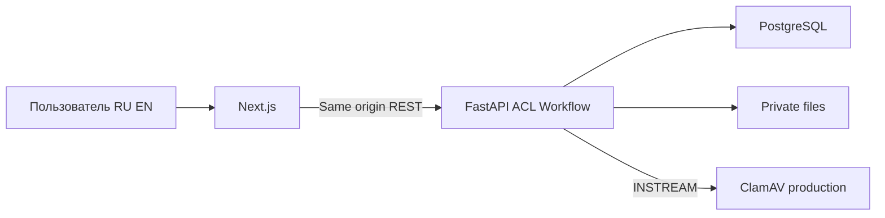

# NEXORA
Корпоративное управление документами. Portfolio project: Iteration 1 и последующие enterprise increments. Наличие реализации в ветке не означает её внедрения в рабочую среду.

## IMPLEMENTED
FastAPI, SQLAlchemy, PostgreSQL, Alembic; Next.js, React, TypeScript. Локальный вход с Argon2id, серверные сессии, CSRF, login throttling; пользователи, 6 ролей, статусы и подразделения; database-backed RU/EN типы документов. Регистрация, metadata, поиск/фильтры, приватные immutable версии PDF/DOCX/TXT и скачивание; submit/cancel/archive; комментарии, activity, admin audit и редактирование доступа пользователей; dashboard из реальных данных; RU/EN. Docker Compose, миграция, development seed и тесты.

## Первый запуск на Windows
Требуется Docker Desktop с Linux containers. Python/Node на хосте не обязательны.
```powershell
cd C:\Users\zamirzhan.janbakiyev\Projects\nexora
# Копировать только если .env ещё не существует:
Copy-Item .env.example .env
docker compose up --build
```
По умолчанию UI http://localhost:3000, API http://localhost:8000/api/docs. Если порт занят, измените WEB_PORT, API_PORT, POSTGRES_PORT в .env; WEB_ORIGIN должен совпадать с адресом браузера.
**Подготовленный локальный .env уже использует UI 3300, API 8800, PostgreSQL 55432 из-за занятых стандартных портов. Не перезаписывайте его без необходимости.**
Миграция/seed запускаются автоматически. PostgreSQL/private uploads сохраняются в named volumes. Остановка: `docker compose stop`; не удаляйте volumes, если нужны данные.

### Development credentials
user@nexora.local, reviewer@nexora.local, approver@nexora.local, legal@nexora.local, manager@nexora.local, admin@nexora.local, other@nexora.local. Пароль задаёт DEMO_PASSWORD в .env; в примере `Nexora-Demo-2026!`. Только синтетические local accounts. Seed требует APP_ENV=development и SEED_DEMO=true, повторный запуск не сбрасывает пароли и пользователей.
LEGAL/other относятся к LEGAL, остальные к IT. Для проверки BOLA создайте документ под USER и откройте под other.

## Проверки
```powershell
docker compose config --quiet
docker compose exec api python -m ruff check .
docker compose exec api python -m mypy app
docker compose exec api alembic check
# Создать одноразовую тестовую БД один раз:
docker compose exec db psql -U nexora -d nexora -c "CREATE DATABASE nexora_test"
# При другом пароле БД измените URL локально:
docker compose exec -e NEXORA_TEST_DATABASE_URL=postgresql+psycopg://nexora:local-development-only@db:5432/nexora_test api python -m pytest -q -o cache_dir=/tmp/nexora-pytest
cd apps/web
npm ci
npm run test
npm run lint
npm run typecheck
npm run build
```
Integration tests принимают только БД nexora_test и очищают только её таблицы. Без NEXORA_TEST_DATABASE_URL они явно skipped; unit tests работают. Не используйте рабочую БД.
Локальный backend: `python -m venv .venv`, `.venv\Scripts\python -m pip install -r requirements.lock`, `.venv\Scripts\python -m pip install --no-deps -e .`; DATABASE_URL и STORAGE_ROOT задаются окружением. Для frontend вне Docker API_INTERNAL_URL задайте **до npm run build**: rewrite фиксируется при сборке.

## Enterprise increment
Implemented: private folders, favorites/archive/trash views, audited restore, custom document types and structured metadata, immutable version restoration/TXT diff; versioned sequential/parallel/conditional workflows with deadlines and idempotent decisions; real ClamAV quarantine/scanning and legacy attestations; session inventory/revocation; safe operator cleanup; backup with isolated restore verification.

Run with antivirus: `docker compose -f compose.yaml -f compose.security.yaml up -d --build`. See [Deployment](docs/deployment.md), [Security](docs/security.md), [Backup/restore](docs/backup-restore.md), [Workflow policy](docs/workflows.md) and [current verification](docs/verification.md).

Текущая ветка содержит ACL Revision 2 и Workflow Hardening: доступ текущего этапа к закреплённой версии, временные персональные допуски и независимые подтверждения RESTRICTED, квитанции без файла, обязательный CAS для PATCH и долговечные ключи повторных операций. Технический ADMIN не получает содержимое автоматически; завершение назначения отзывает его основание доступа. Разделение PostgreSQL-ролей подключается явно через compose.roles.yaml после provisioning; состояние рабочей среды здесь не подтверждается.

Commercial scope remains incomplete: no MFA/SSO, organizational groups/hierarchy, notification delivery, AI, advanced search/exports, external business integrations, tenants or large benchmark. Approval tasks exist; deadlines do not trigger automatic escalation. Mandatory routes are keyed by document type, and operation-key retention remains unresolved. This is a portfolio foundation, not production release certification.

## Документация
[Architecture](docs/architecture.md), [Product](docs/product.md), [Security](docs/security.md), [Iterations](docs/iterations.md), [Data model](docs/data-model.md), [API](docs/api.md), [Verification](docs/verification.md), [Agent guide](AGENTS.md).


### DMS increment
Private nested folders with breadcrumbs and move operations; All/My/Favorites/Archive/Trash views; audited soft delete and restore; immutable old-version restore as a new version; bounded UTF-8 TXT comparison; structured document metadata; administrator-defined types and validated custom fields with generated RU/EN document forms. New migrations append after Iteration 1. See docs/api.md, docs/decisions.md and docs/verification.md. Version-scoped grants are implemented in the current branch; physical purge and later enterprise phases remain planned. This does not establish production readiness.

## System Analysis & Architecture

Аналитическая документация восстановлена по текущему коду портфолио-проекта. AS-IS, предложения TO-BE и неизвестные характеристики разделены; требования не выдаются за согласованный заказ реальной компании.

- [Навигация и карта системы](docs/system-analysis/README.md)
- [BR / FR / NFR](docs/system-analysis/03-business-requirements.md), [процессы и BPMN](docs/system-analysis/06-business-processes.md), [UML](docs/system-analysis/diagrams/README.md)
- [REST API Specification](docs/system-analysis/10-api-specification.md) и [фактический OpenAPI](docs/system-analysis/openapi/fastapi.openapi.json)
- [Data Dictionary и ERD](docs/system-analysis/11-data-model.md), [матрица ACL](docs/system-analysis/13-security-and-access.md)
- [Requirements Traceability Matrix](docs/system-analysis/16-requirements-traceability.md), [Gap Analysis](docs/system-analysis/17-gap-analysis.md)
- [Interview Case Study](docs/system-analysis/18-interview-case-study.md), [отчёт о проверках и ограничениях](docs/system-analysis/IMPLEMENTATION_REPORT.md)


